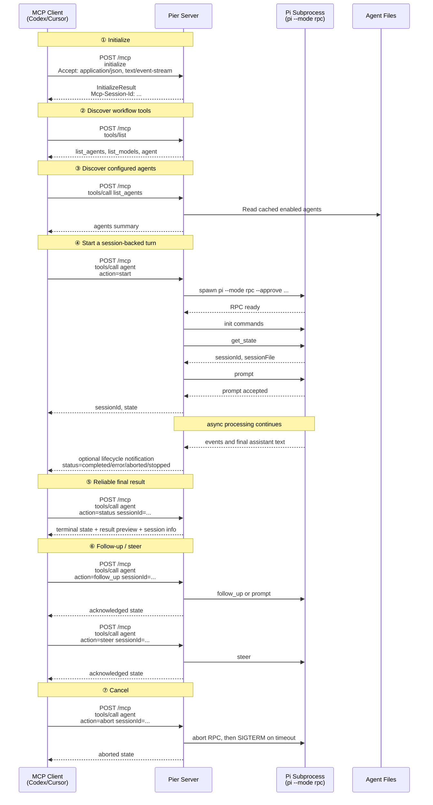

# Pier MCP Interface Design

- **Status**: draft
- **Related**: ADR-0003, ADR-0005, pier-agent-format.md, ../mvp-feature-matrix.md

## Transport

Pier 使用 MCP Streamable HTTP transport，MCP endpoint 固定为单一路径：

```http
/mcp
```

客户端向服务端发送 JSON-RPC message 时必须使用 `POST /mcp`。所有 `POST` 请求必须携带：

```http
Accept: application/json, text/event-stream
```

`initialize` 成功后，Pier 可在 HTTP 响应 header 中返回 `Mcp-Session-Id`；客户端后续请求必须带回该 header，并携带协商后的协议版本：

```http
MCP-Protocol-Version: <negotiated-version>
Mcp-Session-Id: <session-id-after-initialize>
```

`Mcp-Session-Id` 是 MCP transport session header，只用于连接会话和 resumability。它不是 Pi `sessionId`，也不是 `agent.status` / `agent.abort` / `agent.follow_up` / `agent.steer` 的业务参数。

Pier 使用官方 TypeScript SDK 的 Streamable HTTP transport 实现会话与请求处理。

Pier 默认不实现旧版 HTTP+SSE transport。旧 transport 的问题是独立 SSE endpoint 与 endpoint event 模型；不是 `GET /mcp` 本身。Streamable HTTP 仍允许同一个 `/mcp` endpoint 暴露可选的 `GET` server-to-client SSE stream。Pier 使用该 stream 发送 best-effort lifecycle notification，但客户端不能依赖它作为唯一结果通道。除 stream resumption 外，Pier 不在 `GET /mcp` stream 上发送 JSON-RPC response。

当 `POST /mcp` 中的 JSON-RPC request 需要较长处理时间时，Pier 有两种合规响应：

```text
短请求：Content-Type: application/json
       返回一个 JSON-RPC response

长请求：Content-Type: text/event-stream
       在同一个 POST 响应流中发送 notifications/progress，
       最终发送该 request 对应的 JSON-RPC response，然后关闭流
```

Pier 不把最终结果只放在 progress notification 中。`notifications/progress` 只能描述仍处于 active request 的操作；最终结果以 `tools/call` response 或后续 `agent.status` 查询返回。

MVP 不强制实现 `notifications/progress`。对 Pier 而言，session 生命周期比 request 级进度更重要，而 `progress` 更适合有明确阶段或可估算完成度的长 request。

## Tool Model

MVP 暴露稳定的少量 workflow tools，而不是为每个 agent 动态生成一个 MCP tool：

```text
list_agents
list_models
agent
```

原因：

- `tools/list` 在 MCP 客户端中通常会被缓存，动态增删 agent 容易造成客户端认知不一致。
- 稳定 tool 集更适合 Codex、Claude Code、Cursor 等客户端的工具选择模型。
- agent 变化属于业务数据变化，应通过 `list_agents` 查询，而不是通过 MCP tool schema 变化表达。

未来如果要恢复“agent 即 tool”的体验，需要实现缓存、文件监听和 `notifications/tools/list_changed`，并评估目标客户端是否会刷新 tool list。

## Interaction Flow



## Capabilities

Pier declares only standard MCP capabilities:

```json
{
  "capabilities": {
    "tools": {
      "listChanged": false
    },
    "resources": {}
  }
}
```

Notes:

- `streaming: true` is not an MCP server capability and must not be declared.
- `tools.listChanged` remains `false` in MVP because MCP tool names are stable.
- If future design dynamically creates one tool per agent, set `tools.listChanged: true` and emit `notifications/tools/list_changed` after registry changes.
- `resources` is optional. If implemented, resources expose historical session data and run artifacts; core execution must work without resource support.

## Tools

### `list_agents`

Returns enabled and runnable agents. It does not expose full prompt text, resolved CLI flags, or secret-bearing configuration.

Output shape:

```json
{
  "agents": [
    {
      "id": "review",
      "name": "review",
      "description": "Review code changes for bugs, security, and style"
    }
  ]
}
```

### `list_models`

Returns available model summaries from the user's Pi model config. API keys and provider secrets are never returned.

### `agent`

Single workflow tool for session lifecycle operations.

Input schema:

```json
{
  "type": "object",
  "properties": {
    "action": {
      "type": "string",
      "enum": ["start", "status", "abort", "follow_up", "steer"]
    },
    "agentId": {
      "type": "string",
      "description": "Required for action=start"
    },
    "task": {
      "type": "string",
      "description": "Task prompt for start, follow_up, or steer"
    },
    "sessionId": {
      "type": "string",
      "description": "Pi session id for status, abort, follow_up, or steer"
    },
    "cwd": {
      "type": "string",
      "description": "Working directory for action=start"
    },
    "model": {
      "type": "string",
      "description": "Optional one-session model override"
    }
  },
  "required": ["action"]
}
```

MVP supports:

```text
start
status
abort
follow_up
steer
```

`follow_up` and `steer` are part of MVP. Pier must route them by `sessionId` and wait for Pi to acknowledge the RPC command before returning. If Pi rejects the command, Pier returns a tool error to the client.

Action behavior:

- `start`: validate inputs, start Pi, obtain `sessionId`, send first prompt, return only after Pi accepts the prompt.
- `status`: read current session state and bounded assistant preview by `sessionId`.
- `follow_up`: append a later instruction to an existing session. If the session is running, queue through Pi `follow_up`; if the session is completed/idle, continue the session with a new prompt-compatible command.
- `steer`: redirect a currently running session. If the session is not running/streaming, return `session_not_running` and suggest `follow_up`.
- `abort`: abort the active session work by `sessionId`.

## Session Identifier

Pier exposes one identifier to MCP clients:

```text
sessionId  Pi-owned session id from get_state. Used for status, abort, follow_up, steer, resume, and history correlation.
```

`agent.start` must return a `sessionId` on success. Pier does not return success until all startup steps below have completed:

```text
1. Spawn Pi subprocess.
2. Establish Pi RPC readiness.
3. Send Pier-controlled init commands.
4. Call get_state and read sessionId/sessionFile.
5. Send the first prompt.
6. Receive Pi response success=true for that prompt command.
```

If any step fails, Pier returns a structured tool error and should clean up the partially started subprocess. A successful `agent.start` therefore means the client has a real, queryable session.

Example `agent.start` response:

```json
{
  "content": [
    {
      "type": "text",
      "text": "{\"sessionId\":\"01J5A...\",\"status\":\"running\"}"
    }
  ],
  "structuredContent": {
    "session": {
      "sessionId": "01J5A...",
      "agentId": "review",
      "status": "running",
      "sessionFile": "~/.pier/sessions/.../20260618_01J5A.jsonl"
    }
  }
}
```

## Reliable Result Delivery

Pier does not rely on SSE delivery for the final result. The reliable path is:

1. `agent.start` returns `sessionId` after Pi accepts the initial prompt.
2. Client periodically calls `agent.status` with `sessionId`.
3. `agent.status` returns current status, error/result preview, and event cursor metadata.
4. Optional `resources/read` or future event pagination can fetch larger transcripts.

Example terminal status:

```json
{
  "structuredContent": {
    "session": {
      "sessionId": "01J5A...",
      "agentId": "review",
      "status": "completed",
      "lastAssistantTextPreview": "Found two issues...",
      "eventCount": 42,
      "lastEventSeq": 42
    }
  },
  "content": [
    {
      "type": "text",
      "text": "completed: Found two issues..."
    }
  ]
}
```

For large final outputs, `lastAssistantTextPreview` stays bounded. The full transcript is exposed through session resources or a future MCP event pagination tool, not in every status response.

## Progress Notifications

`progressToken` is a standard MCP request metadata field, not a Pier tool argument. A client may include it under `params._meta.progressToken`; Pier must not put it in the `agent` input schema.

If the client sends `_meta.progressToken`, Pier may send `notifications/progress` while that MCP request is active. Progress notifications follow MCP rules:

- `progressToken` must refer to an active request.
- the token is chosen by the client and must be a string or integer.
- the token must be unique across the client's active requests.
- `progress` must monotonically increase.
- `message` should be human-readable, not only a raw state string.
- progress stops after the request completes.

MVP can choose not to emit any `notifications/progress` at all. For `agent.start`, the default design is simply to block until `sessionId` is ready, then return success or error.

If Pier later emits progress for `agent.start`, it should only cover coarse request-scoped startup milestones before the `sessionId` response: spawn, RPC ready, `get_state`, prompt accepted. After the `agent.start` response is sent, the start request is no longer active, so Pier must not continue sending `notifications/progress` for that token. Long-running session lifecycle updates are delivered through lifecycle notifications and `agent.status`.

Example:

```json
{
  "jsonrpc": "2.0",
  "method": "notifications/progress",
  "params": {
    "progressToken": "task-abc-456",
    "progress": 0.2,
    "total": 1,
    "message": "Pi session started"
  }
}
```

Terminal progress is allowed only for a request that stays open until terminal completion:

```json
{
  "jsonrpc": "2.0",
  "method": "notifications/progress",
  "params": {
    "progressToken": "task-abc-456",
    "progress": 1,
    "total": 1,
    "message": "Session turn completed"
  }
}
```

Terminal progress must not be the only place containing the final result. Clients should treat it as a notification and use `agent.status` for reliable retrieval.

For Pier's MVP, lifecycle notifications are preferred over request progress notifications.

## Lifecycle Notifications

Pier should notify capable clients when a session changes status. This avoids clients waiting only on a timer while still keeping `agent.status` as the reliable source of truth.

Lifecycle notifications are best-effort. They can be delivered on a Streamable HTTP SSE response while the request is still active, or on the `GET /mcp` server-to-client stream. Clients that do not receive notifications must still poll `agent.status`.

Pier should emit lifecycle notifications for user-visible status changes so capable clients do not have to wait for the next polling interval to learn that a session completed, errored, was aborted, or was stopped. Notifications are wake-up signals, not the source of truth.

Pier-specific lifecycle notification:

```json
{
  "jsonrpc": "2.0",
  "method": "notifications/pier/session_status_changed",
  "params": {
    "sessionId": "01J5A...",
    "agentId": "review",
    "status": "completed",
    "message": "Turn completed",
    "lastAssistantTextPreview": "Found two issues...",
    "eventCount": 42,
    "lastEventSeq": 42
  }
}
```

Emit lifecycle notifications for:

```text
running
completed
error
aborted
stopped
```

Notifications must be small and redacted. Full transcripts remain behind `agent.status`, resources, or paginated event APIs.

## Cancellation

Pier supports cancellation through `agent({ action: "abort" })` in MVP. This is the reliable user-facing API because clients consistently support tool calls.

MCP `notifications/cancelled` may also arrive for an active JSON-RPC request. Pier should treat it as cancellation of that specific request, not as a generic session abort unless the request maps unambiguously to a `sessionId`.

Abort sequence:

```text
1. Send Pi RPC abort.
2. Wait for a short grace period.
3. Send SIGTERM if the subprocess is still alive.
4. Escalate to forced kill after timeout.
5. Mark session as `aborted` or `stopped` and emit one terminal event.
```

## Agent Registry And `tools/list`

Agent definition discovery is not performed inside `tools/list`. Pier loads and validates agent definitions through the registry layer, then serves cached summaries through `list_agents`.

Registry changes should be visible to MCP clients through the stable `list_agents` tool. If the registry later supports hot reload, Pier can emit a session- or registry-level event through REST/Web SSE; MCP `notifications/tools/list_changed` is only needed if MCP tool definitions themselves change.

## Session History

Optional MCP resources may expose session history:

```text
resources/list   List completed session artifacts.
resources/read   Read a bounded session artifact or transcript excerpt.
```

Resources must use bounded reads or pagination. Full `.jsonl` transcripts can be large and may contain sensitive command output, so responses must be redacted and size-limited.

## Client Compatibility

```text
Client          │ Expected path
────────────────│────────────────────────────────────────────
Codex           │ Streamable HTTP, tools, poll status; notifications optional
Claude Code     │ Streamable HTTP, tools, poll status; notifications optional
Cursor          │ Streamable HTTP, tools, poll status; notifications optional
Continue        │ Streamable HTTP, tools, poll status; notifications optional
Claude Desktop  │ tools plus optional resources/notifications
```

The design intentionally avoids requiring clients to keep a long-lived `GET /mcp` SSE stream open, because support varies across clients. When a client does open Streamable HTTP's optional `GET /mcp` stream, Pier can use it for lifecycle notifications.

## State Machine

MCP-visible status follows ADR-0003.

```text
Status     │ Meaning
───────────│────────────────────────────────────────────
starting   │ Pi subprocess/RPC startup or first prompt acceptance
running    │ Pi subprocess is active and processing
completed  │ Latest turn ended successfully; session can accept follow_up
error      │ Subprocess, protocol, or validation failure
aborted    │ Client requested abort or timeout fired
stopped    │ Dashboard/user signal stopped the session
```

Internal implementations may additionally track `queued` or `idle`, but public MCP status must collapse to the ADR-0003 lifecycle unless a new ADR changes the state model.

## Non-goals

- No deprecated HTTP+SSE transport.
- No reliance on standalone `GET /mcp` as the only result channel.
- No `tasks/` extension until major clients support it consistently.
- No dynamic MCP tool per agent in MVP.
- No full transcript in default `agent.status`.
- No `resources/subscribe` for sessions.
